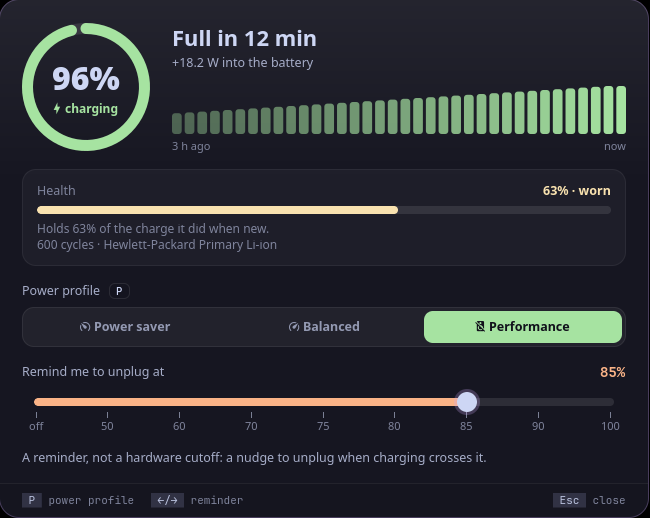

<p align="center">
  <picture>
    <source media="(prefers-color-scheme: dark)" srcset="assets/banner-dark.svg">
    <source media="(prefers-color-scheme: light)" srcset="assets/banner-light.svg">
    
  </picture>
</p>

<!-- identity -->
<p align="center">
  <b>यदादित्यगतं तेजो जगद्भासयतेऽखिलम् ।<br>
  यच्चन्द्रमसि यच्चाग्नौ तत्तेजो विद्धि मामकम् ॥</b><br>
  <i>The radiance of the sun that lights the whole world, and that in the moon and in fire: know that radiance as mine.</i><br>
  <sub>Bhagavad Gītā 15.12</sub>
</p>
<!-- /identity -->

<p align="center">
  <b>Battery at a glance: charge ring, time left, power draw, health and cycles, power profile, a charge-limit reminder.</b><br>
  The battery at a glance. A tool for <a href="https://github.com/Theyashsawarkar/vyom">Vyom</a>, keyboard-driven panels for Wayland.
</p>

<p align="center">
  <a href="https://github.com/Theyashsawarkar/urja/actions/workflows/ci.yml"></a>
  <a href="https://github.com/Theyashsawarkar/urja/releases"></a>
  <a href="LICENSE"></a>
  <a href="https://github.com/Theyashsawarkar/vyom"></a>
  
  
</p>

<p align="center">
  
</p>

> *Urja* (ऊर्जा) is Sanskrit for "energy": the energy your laptop runs on.

urja is the battery at a glance for [Vyom](https://github.com/Theyashsawarkar/vyom): one keyboard-driven panel that opens instantly, with live data, a preview and a key for everything. It runs on any compositor with the layer-shell protocol (sway, Hyprland, river, niri, Wayfire, labwc…). In [Vayu](https://github.com/Theyashsawarkar/vayu), the desktop it was built for, it replaces battery-limit-picker.py.

## Contents

- [Features](#features)
- [Install](#install)
- [Usage](#usage)
- [Configuration](#configuration)
- [Troubleshooting](#troubleshooting)
- [The Vyom family](#the-vyom-family)
- [Contributing](#contributing)
- [License](#license)

## Features

- **Time to full or time left as the headline**, next to a big **charge ring** (green, yellow when low, red when nearly empty, with the state in words).
- The **power draw in watts**. Batteries that don't report a current (some HP firmware) get an estimate from how fast the charge moved over the last half hour, marked "about".
- A **charge graph of the last 3 hours**: UPower's own history (read over D-Bus, no root needed), filled in with samples urja takes itself while Vyom runs.
- **Health as a bar with a word**: green good (80%+), yellow worn, red replace (under 60%), with what it means in plain words, the cycle count and the battery's make.
- The **power profile** (power-profiles-daemon) as a segmented control with the current one filled; a click or `P` switches it.
- With `limit_file` set, a **charge-limit reminder** slider with its value in peach: the percentage a watcher of yours nudges you to unplug at.
- `vyom urja demo` shows made-up numbers (for screenshots, or to try it on a desktop).
- Works with both kinds of battery driver (energy_* / power_now, or charge_* / current_now).
- Keyboard first: every action has a key, shown in the footer; the mouse works too.

## Install

### Requirements

- [Vyom](https://github.com/Theyashsawarkar/vyom) 0.6.0 or newer (Python 3.11+, PyGObject, GTK 4, [gtk4-layer-shell](https://github.com/wmww/gtk4-layer-shell), a Nerd Font)
- optional: powerprofilesctl (power profile)

### Install

```sh
git clone https://github.com/Theyashsawarkar/urja ~/.local/share/vyom/plugins/urja
vyom reload           # pick it up (or log out and in)
vyom urja            # open it; run it again to close
```

Give it a key in your compositor, e.g. sway:

```sh
bindsym $mod+<key> exec vyom urja
```

### Update and uninstall

```sh
git -C ~/.local/share/vyom/plugins/urja pull && vyom reload     # update
rm -rf ~/.local/share/vyom/plugins/urja && vyom reload          # uninstall
```

## Usage

Open it with `vyom urja` (or your key). The footer always shows the keys.

| Key | Action |
|---|---|
| `Left / Right` | Set the charge-limit reminder (on the slider) |
| `P` | Switch the power profile |
| `Esc` | Close the panel |

Every Vyom panel also has `Up`/`Down` (or `Ctrl+K`/`Ctrl+J`) to move and `Page Up`/`Page Down` to jump. Each tool opens from its own key.

## Configuration

Everything is optional, in `~/.config/vyom/config.toml` under `[plugin.urja]`:

| Setting | Default | What it does |
|---|---|---|
| `limit_file` | (unset: no slider) | File holding the reminder percentage (Vayu: ~/.local/state/battery-limit/threshold) |

Run `vyom reload` after editing.

## Troubleshooting

- **Nothing opens.** `vyom list` shows every installed tool, and why one is skipped (a missing requirement, or a Vyom that's too old).
- **It opened, then something failed.** Look for a `Traceback` in the daemon's log, `journalctl --user -u vyom -u vyom-daemon -b` (without systemd: `~/.local/state/vyom/daemon.log`), and [open an issue](https://github.com/Theyashsawarkar/urja/issues/new/choose) with it.
- **No blur or rounded corners.** That's the compositor: on SwayFX, add `layer_effects "vyom" { blur enable; corner_radius 20; shadows enable }`.

## The Vyom family

Each tool is its own repository, so you install only the ones you want:

| Tool | | What it does |
|---|---|---|
| [dvara](https://github.com/Theyashsawarkar/dvara) | द्वार, gateway | The app launcher |
| [ganit](https://github.com/Theyashsawarkar/ganit) | गणित, mathematics | The calculator and converter |
| [smriti](https://github.com/Theyashsawarkar/smriti) | स्मृति, memory | Clipboard history |
| [bhava](https://github.com/Theyashsawarkar/bhava) | भाव, feeling, emotion | The emoji picker |
| [tarang](https://github.com/Theyashsawarkar/tarang) | तरंग, wave | Wi‑Fi and the hotspot |
| [setu](https://github.com/Theyashsawarkar/setu) | सेतु, bridge | Bluetooth |
| [doot](https://github.com/Theyashsawarkar/doot) | दूत, messenger | Your phone, through KDE Connect |
| [patra](https://github.com/Theyashsawarkar/patra) | पात्र, vessel | Docker containers |
| [akashvani](https://github.com/Theyashsawarkar/akashvani) | आकाशवाणी, voice from the sky | Notifications |
| [raga](https://github.com/Theyashsawarkar/raga) | राग, melody | YouTube music and video |
| [mudra](https://github.com/Theyashsawarkar/mudra) | मुद्रा, gesture | Keybinding search |
| [urja](https://github.com/Theyashsawarkar/urja) (this one) | ऊर्जा, energy | The battery at a glance |
| [vishram](https://github.com/Theyashsawarkar/vishram) | विश्राम, rest | The power menu |
| [kendra](https://github.com/Theyashsawarkar/kendra) | केन्द्र, centre | Quick settings |

## Contributing

Bug reports, ideas and pull requests are welcome: see [CONTRIBUTING.md](CONTRIBUTING.md) for the development setup and the few rules every tool follows, and [CHANGELOG.md](CHANGELOG.md) for what changed in each release. Please report security issues privately ([SECURITY.md](SECURITY.md)).

## License

[MIT](LICENSE).
